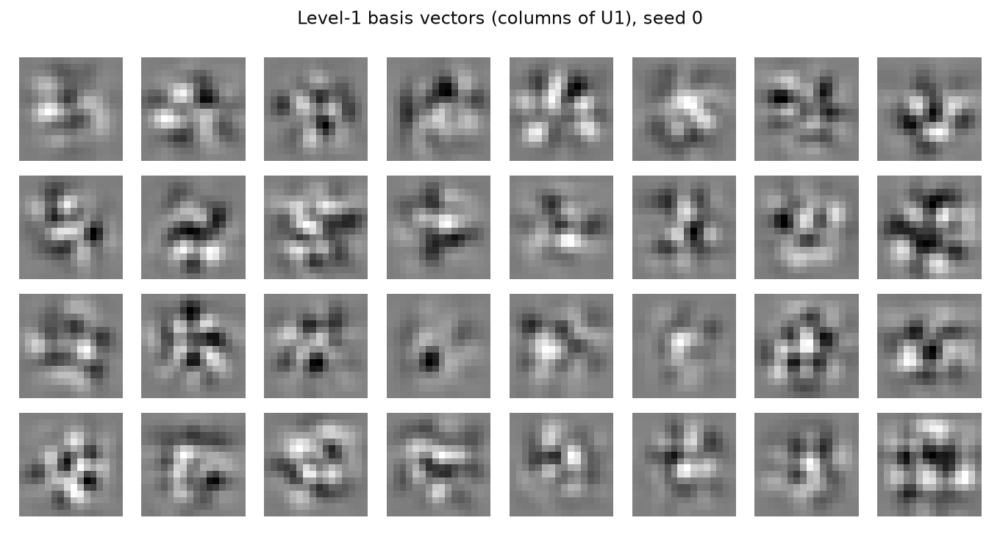
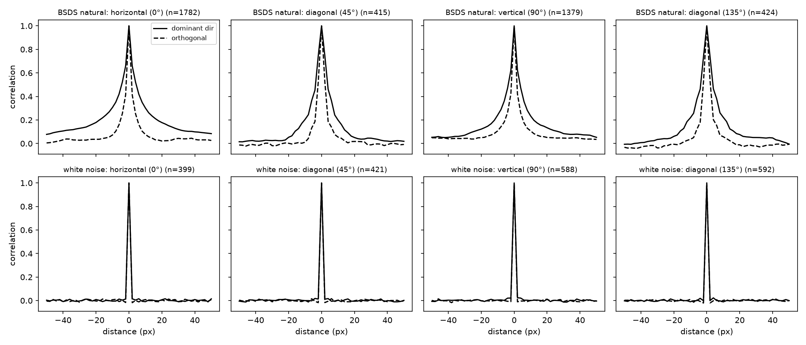
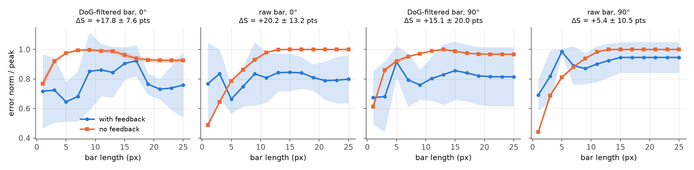
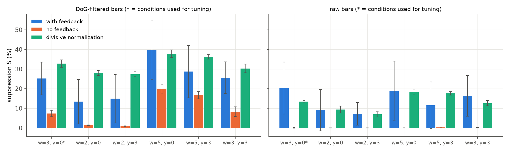
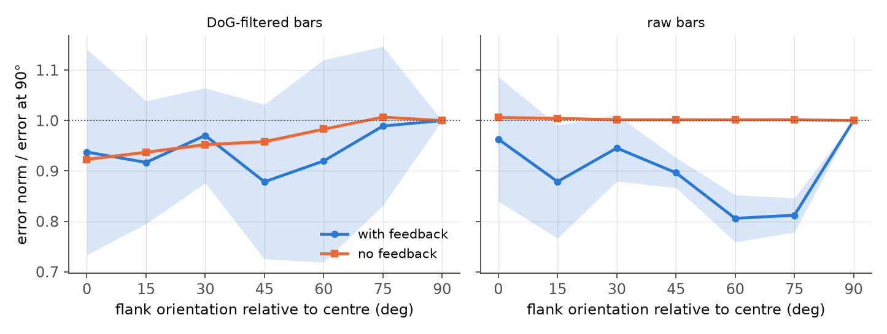

# Predictive coding in the visual cortex: a partial replication of Rao & Ballard (1999) and a quantification of feedback-dependent error suppression

*CG 501 Computation and Cognition, course project. Code, data pointers and every figure in this report are regenerated by the scripts in `experiments/` (see the README).*

## Abstract

Rao and Ballard (1999) proposed that cortical feedback carries predictions of lower-level activity while feedforward connections carry the residual prediction error, and showed in simulation that error-detecting neurons in such a hierarchy reproduce endstopping and other extra-classical receptive-field effects. We re-implemented their two-level network from its equations, trained it on BSDS500 natural images, and tried to reproduce three of their results (learned receptive fields, endstopping, and its loss when feedback is removed). The replication is only partial: the network trains and level 2 couples the centre and flanking modules, but the feedback-dependent endstopping is much weaker than reported, and the learned receptive fields are noisy rather than Gabor-like. As the extension, we quantified the error signal systematically: the population error norm of the central module as a function of bar length, with and without feedback, over five independently trained networks with confidence intervals and a held-out set of stimuli. Feedback accounts for roughly 7 to 20 percentage points of length-dependent suppression for bars that extend across modules (for raw bars at the tuning width, +20.2 ± 13.2 points, p = 0.013), and we found no orientation-contrast effect. A feedback-free divisive normalization with one fitted parameter reproduces suppression of similar size, so these data alone do not isolate top-down prediction as the cause.

## 1. Introduction

**Background.** Neurons in V1 and other areas respond less to a stimulus that extends beyond the classical receptive field (RF), for example a line segment whose length exceeds the optimal length ("endstopping"), when the surround matches the centre in orientation. Rao and Ballard (1999) proposed a functional interpretation: the visual system learns a hierarchical generative model of natural images, higher areas send predictions down, and the quantity passed up is the residual error. Because natural images contain long, smooth structures, a bar that extends into the surround is predicted from context, so error neurons respond little; an isolated short bar is not predicted, so they respond strongly.

**Related work.** Retinal and LGN centre-surround coding has long been interpreted as spatial and temporal prediction (Srinivasan et al., 1982; Atick, 1992; Dong & Atick, 1995). Sparse coding explains simple-cell RFs (Olshausen & Field, 1996). Divisive normalization offers a feedback-free account of surround suppression (Heeger, 1992; Simoncelli, in Rao & Ballard, 1999).

**Objectives and hypothesis.** (i) Reproduce the paper's baseline: oriented level-1 RFs (their Fig. 2), endstopping in the error neurons (Fig. 3), and its removal by deleting feedback (Fig. 5). (ii) *Extension:* measure the error signal systematically. *Hypothesis:* if endstopping reflects prediction error, the central error norm should fall as a bar extends into the surround, this fall should largely vanish without feedback, and it should depend on whether the surround is aligned with the centre.

## 2. Methods

### 2.1 Model

Following the paper, an image patch **I** is generated from causes **r** by **I** = f(**Ur**) + noise (Eq. 1), with f(x) = x. Level 1 has three modules (left, centre, right) that look at 16×16 Gaussian-windowed patches offset horizontally by 5 px, so level 2 sees a 16×26 region. The three level-1 modules share one weight matrix **U₁** (256×32). Level 2 has 128 neurons whose weights **U₂** (96×128) predict the 96 concatenated level-1 responses (Eq. 3). Responses are found by gradient descent on the negative log posterior E (Eqs. 4 to 7; Gaussian priors); weights follow a Hebbian rule with weight decay (Eq. 9). The error-detecting neurons of level 1 compute **r** − **r**ᵗᵈ, where **r**ᵗᵈ = **U₂r₂** is the top-down prediction.

*Figure 1. Learned level-1 basis vectors (columns of U₁) for seed 0. They are localized and structured but noisier than the paper's Gabor-like Fig. 2b.*

### 2.2 Data and preprocessing

The paper's five images are not available, so we used the 200 training images of BSDS500 (grayscale, 481×321). Images were prewhitened with a difference-of-Gaussians filter (σ = 1 and 1.6 px, our choice) and scaled to unit standard deviation. Random 16×26 regions were sampled for training; the 100 validation images were used for sanity checks.

### 2.3 Training and stimuli

Level 1 was trained first (5000 batches of 4 regions), then level 2 with U₁ frozen, as in the paper's Methods. For each of five seeds we trained a full network. Stimuli were dark bars (width 3 px unless stated) of varying length centred in the 16×26 region, either DoG-filtered like natural images ("DoG bars") or unfiltered ("raw bars"), at 0° (extending into the flanking modules) and 90°. The response of an error neuron is |r − rᵗᵈ| of the central module; without feedback it is |r|. For the population we use the Euclidean norm over the 32 central error neurons. Suppression was defined as S = (peak − plateau)/peak × 100 with plateau the mean over lengths above 18 px.

### 2.4 Deviations from the paper

A number of changes were needed to obtain a stable network; they matter for how the results should be read.

- Different images (BSDS500) and our own prewhitening and window widths.
- A step size for the inference dynamics scaled by the spectral norm of U (the paper integrates a continuous-time equation).
- A constant learning rate (k₂ = 0.05 for level 1; the paper decays k₂ by 1.015 every 40 inputs) and batch updates scaled to mimic per-input steps.
- Level-1 responses divided by one fixed constant (their rms after stage 1) before entering level 2. Without this, U₂ collapsed to zero under weight decay because the Gaussian prior (α = 1) shrinks level-1 responses to a small scale.
- Level-2 settings α₂ = 0.01, λ₂ = 0.002, k₂ = 0.5, chosen by a small grid sweep (σ²_td ∈ {1, 10}, α₂ ∈ {1, 0.1, 0.01}, λ₂ ∈ {0.02, 0.002}, k₂ ∈ {0.05, 0.5}) that maximized the feedback effect on the DoG and raw bars of width 3 px. The paper's own values (α = 1, λ = 0.02) gave essentially no feedback effect in our implementation.
- Gain adaptation of basis vectors (from the paper's reference 26) was tried and abandoned because it killed units.

## 3. Results

### 3.1 Replication

*Learned RFs (paper Fig. 2).* Level-1 basis vectors (Figure 1) are localized by the Gaussian window and show some edge-like structure, but many are irregular. A linear-Gaussian generative model only determines the subspace spanned by the basis vectors, not a rotation within it, so Gabor-like RFs are not guaranteed; the paper's clean RFs probably depend on details not specified (training length, input scaling, image set).

*Natural-image statistics (paper Fig. 4).* The paper's argument requires oriented structure to extend over long distances. On BSDS500 the correlation along the dominant orientation is 3 to 6 times the orthogonal one (e.g. 0.18 vs 0.03 at ±20 px for horizontal structure), and a white-noise control is flat (Figure 2). The magnitude is about half the paper's, and diagonal structures are weak.

*Figure 2. Correlation between a 16×16 patch and translated copies along the dominant orientation (solid) and orthogonal to it (dashed), for natural images (top) and white noise (bottom).*

*Endstopping (paper Figs. 3 and 5).* With the paper's level-2 parameters, a single network showed 6/32 error neurons with more than 50% endstopping with feedback and 5/32 without (mean 29.1% vs 25.5%); the paper reports 28/32 and 5/32 (82% removed). With the tuned level-2 settings, averaged over five seeds, the counts were 12.2/32 with feedback and 10.8/32 without for DoG bars (mean endstopping 41.1 ± 13.6% vs 38.6 ± 3.9%), and 9.8/32 vs 6.2/32 for raw bars (33.5 ± 8.7% vs 25.3 ± 6.0%). Endstopping with DoG bars is largely present without feedback because DoG filtering removes the interior of a long bar, so it is a property of the input and not of prediction. We therefore consider the paper's endstopping result **not reproduced**; a modest, feedback-dependent component exists for raw bars.

### 3.2 Extension: feedback-dependent suppression of the error norm

*Figure 3. Central-module error norm (normalized to its peak) versus bar length, with feedback (blue) and without (orange); mean ± 95% CI over five seeds. The title gives ΔS, the paired difference in suppression index.*

Without feedback the response (|r|) rises with bar length and plateaus, as a feedforward filter should. With feedback the error norm is lower at long lengths, giving a suppression index S of 25.2 ± 8.3% (DoG, 0°) and 20.3 ± 13.2% (raw, 0°) against 7.3 ± 1.7% and 0.1 ± 0.1% without feedback. The paired differences (+17.8 ± 7.6 and +20.2 ± 13.2 points; p = 0.003 and 0.013) are significant. For 90° bars, which can extend only along the module's own column, the difference is not significant (+15.1 ± 20.0, p = 0.10; +5.4 ± 10.5, p = 0.23). Individual seeds vary considerably (note the wide bands), so the effect is real in sign but imprecisely estimated with n = 5.

### 3.3 Held-out stimuli

To limit circularity from tuning level 2 on width-3 bars, we evaluated the same networks, with no re-tuning, on bars of width 2 and 5 px and with a 3 px vertical offset (Figure 4).

*Figure 4. Suppression index S for six stimulus conditions (the first, marked *, is the tuning condition) with feedback, without feedback, and under a feedback-free divisive normalization (one fitted parameter). Mean ± 95% CI over five seeds.*

The feedback effect keeps its sign in all ten held-out conditions (+7 to +20 points); seven reach p < 0.05 and three lie between 0.057 and 0.077. The size of the effect is thus about 7 to 20 points, not a precise value.

### 3.4 Surround orientation

*Figure 5. Error norm for a horizontal centre bar with flanking bars at relative orientation Δ, normalized to Δ = 90°; mean ± 95% CI.*

In the paper an aligned surround suppresses the response relative to an orthogonal surround and an orientation contrast enhances it (their Fig. 6). We observed a ratio error(Δ = 0°)/error(Δ = 90°) of 0.94 ± 0.20 with feedback and 0.92 ± 0.00 without (DoG), and 0.96 ± 0.12 vs 1.01 ± 0.00 (raw); the differences are not significant (p = 0.85 and 0.40). We did not reproduce orientation-contrast effects.

## 4. Discussion

**What the model explains.** A hierarchical predictive-coding network can be trained on natural images with the paper's equations, and its top-down prediction is informative about the central responses (explained variance 0.93 to 0.96 on validation images). With feedback, the central error norm is reduced more for long bars that extend across modules than without it (Figure 3), qualitatively the paper's claim, and in a direction that persists across held-out bar widths and offsets.

**Where it fails.** The magnitude is far from the paper's (feedback removed 82% of endstopping there; here at most 18 to 20 points of S), the learned RFs are noisier, and the orientation-contrast effect is absent. Two diagnostics suggest why. First, when we trained level 2 with n₂ = 4 to 32 units the unexplained fraction was *lowest for short bars and rose when the bar reached the flanks*, the opposite of the paper's argument: with 128 units, level 2 simply reconstructs its input (about 90% of every response is predicted at every length, so no length dependence); with fewer units it learns low-order structure that flanking content makes harder, not easier, to predict. Second, the three level-1 windows overlap by 11 of 16 pixels, so flank-only prediction of the centre is excellent for *any* stimulus (explained variance 0.86 on natural images), leaving little room for context-specific effects. The long-range oriented structure the paper relies on is present in BSDS500 but weaker (Figure 2).

**One alternative explanation.** The same suppression-versus-length pattern is produced by a model with no feedback at all: the central response divided by √(1 + β × flank energy) (divisive normalization), with a single β fitted on the tuning conditions, gives S = 7 to 18% for raw bars (7 to 20% with feedback) and 27 to 38% for DoG bars (13 to 40%). Our bar-length data therefore cannot distinguish a learned top-down prediction from a hard-wired surround normalization. Distinguishing them would require a manipulation that depends on learning, for example changing the training image statistics, or stimuli whose predictability is dissociated from flank energy.

**Limitations.** (i) Only five seeds and wide confidence intervals; the exact size of the effect is uncertain. (ii) Level-2 hyperparameters were tuned on the same stimulus family used to measure the effect, mitigated but not eliminated by the held-out check; the baseline paper values give no effect in our implementation. (iii) Several implementation choices (Section 2.4) are not in the paper and plausibly differ from the original, which makes failure to reproduce its magnitude uninformative about the paper's claim itself. (iv) The error response is measured as a population norm, not per neuron with each neuron's preferred orientation, and a linear generative model was used for all bar simulations. (v) We used a different image set.

**Future directions.** Train on images selected for strong oriented structure; compare Gaussian and kurtotic priors (the paper's Fig. 6 used a sparse prior with a nonlinear f, which we did not run); implement the lateral-inhibition formulation (Eq. 8); add temporal prediction; test predictions that separate feedback from normalization.

## 5. References

- Atick, J. J. (1992). Could information theory provide an ecological theory of sensory processing? *Network* 3, 213-251.
- Dong, D. W. & Atick, J. J. (1995). Temporal decorrelation: a theory of lagged and nonlagged responses in the lateral geniculate nucleus. *Network* 6, 159-178.
- Heeger, D. J. (1992). Normalization of cell responses in cat striate cortex. *Visual Neuroscience* 9, 181-197.
- Martin, D., Fowlkes, C., Tal, D. & Malik, J. (2001); Arbelaez, P., Maire, M., Fowlkes, C. & Malik, J. (2011). Contour detection and hierarchical image segmentation (BSDS500). *IEEE TPAMI* 33, 898-916.
- Olshausen, B. A. & Field, D. J. (1996). Emergence of simple-cell receptive field properties by learning a sparse code for natural images. *Nature* 381, 607-609.
- Rao, R. P. N. & Ballard, D. H. (1999). Predictive coding in the visual cortex: a functional interpretation of some extra-classical receptive-field effects. *Nature Neuroscience* 2, 79-87.
- Srinivasan, M. V., Laughlin, S. B. & Dubs, A. (1982). Predictive coding: a fresh view of inhibition in the retina. *Proc. R. Soc. Lond. B* 216, 427-459.

*Dataset licence:* BSDS500 is distributed by UC Berkeley for research use; confirm the terms on the Berkeley BSDS page before submission.

## 6. Contribution statement

*To be completed by the team: who implemented the model, who ran the experiments, who wrote which section.*

## 7. AI use disclosure

The code (`src/`, `experiments/`), the experiments, the figures and the first draft of this report were produced with Claude Code (an AI coding assistant) working from the team's instructions and the paper. The team should verify all numbers by re-running the scripts (`experiments/make_report_figures.py`, results in `results/report_stats.json`) and review the interpretation before submission.
